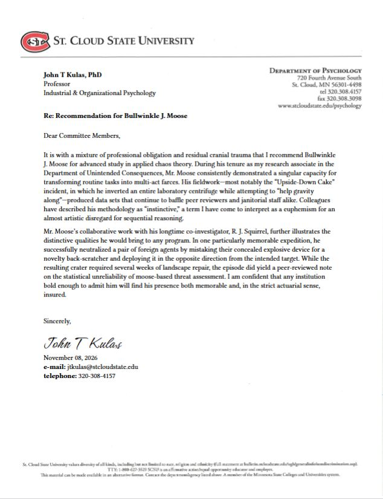
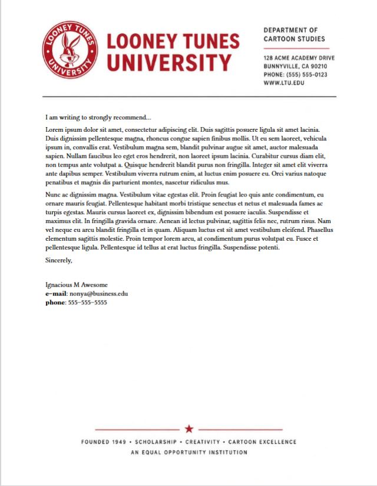
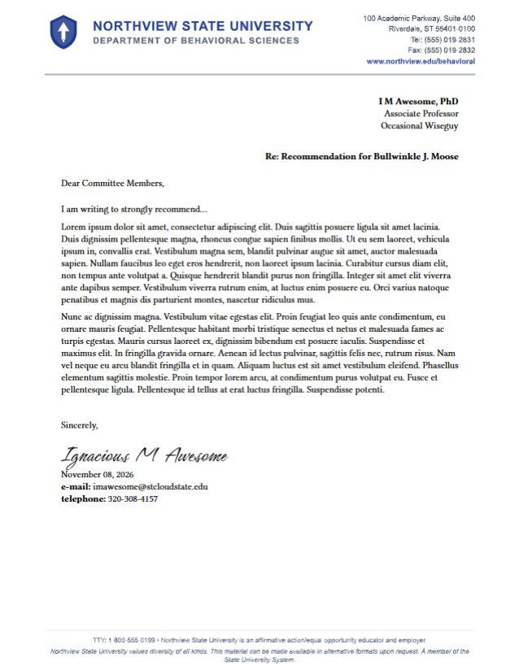
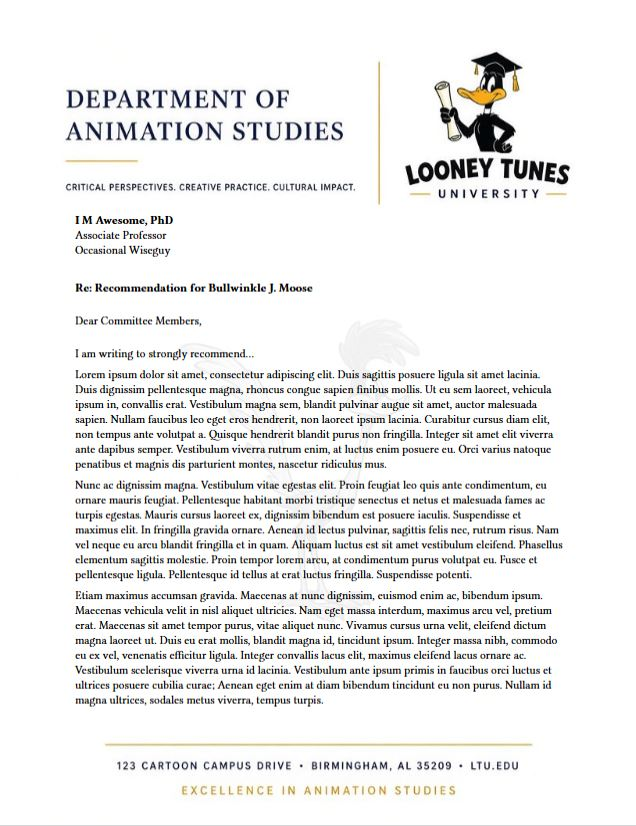

# Letters of Recommendation - Quarto 

[](example.pdf)

`recletters` generates typst pdf recommendation letters. The first page of the letter will be rendered on user--provided electronic letterhead (.pdf, .png, .jpg, .svg, & .webp letterhead formats are supported - pdf is preferred). Letterhead is typically restricted to organizational representatives -- `recletters` allows approved users to maintain local copies of their institution's letterhead while still using Quarto as an authoring tool. 

> [!NOTE]
> Some Universities provide only .doc/.docx letterhead templates. These are not currently supported. If your institution distributes only .doc/.docx letterhead, you should save the .doc/.docx as .pdf (or other similar workaround).

## Installing

```bash
quarto use template jtkulas/recletters-typst
```

This will install the extension under the `_extensions` subdirectory.

## Using

Identify the extension within your YAML with `format: recletters-typst`. 

The letterhead should be stored locally and is identified with `background: letterhead.*`:

```bash
---
format:
  recletters-typst:
    background: letterhead/looney.pdf  
---

I am writing to **strongly recommend**...

```

The [minimal specification](minimal.qmd) (`format: recletters-typst` and `background: letterhead.*`) will provide a workable letter writing canvas. Optional specifications control header blocks, signature blocks, and header and footer spacing (to accommodate different letterhead stylings).

### Optional specifications

Everything listed below is optional and organized by effect ([address block](#address-block), [signature block](#signature-block), or [general formatting](#general-formatting)):

#### Address block

These options populate a small block of text to be located at the head of the document, situated either right or left (see `from-align`.

|Option   | Description           |  Default Value         |  Example  |
|---------|-----------------------|------------------------|-----------|
|from-name    | letter writer (or addressee)  | NULL      | from-name: "I. M. Awesome"     |
|from-title   | job title of letter writer (or addressee) | NULL | from-title: "Assistant Professor"  |
|from-affiliation    | department affiliation of letter writer (or addressee) | NULL | from-affiliation: "Biosciences"   |
|from-align | location of "from" block: `left` or `right` | left  | from-align: right  |

#### Signature block

These options populate a small block of text to be located at the foot of the document, left-justified. The script font is the google font, "[Hurricane](https://fonts.google.com/specimen/Hurricane?preview.script=Latn)", which comes bundled with the extension install.   

|Option   | Description           |  Default Value         |  Example  |
|---------|-----------------------|------------------------|-----------|
|closing    | salutation to appear above signature  | NULL      | closing: "Insincerely,"     |
|signature   | name to appear in script font | NULL | signature: "Ignacious M Awesome"  |
|date    | use `date: today` for auto-complete in Month day, Year format | NULL | date: today   |
|email | email address of letter writer | NULL  | email: "imawesome@looneytunes.edu"  |
|phone    | letter writer's phone number  | NULL      | phone: "320-555-1234"     |

#### General formatting

`emptyhead` provides "vertical text shifting" for letter writers whose letterhead content likely differs in "thickness". Negative values are allowed (e.g., `emptyhead: -2` will shift the entire text "up" two rows).

|Option   | Description           |  Default Value         |  Example  |
|---------|-----------------------|------------------------|-----------|
|subject | bolded "Re:..." to be rendered above opening line | NULL | subject: "Recommendation for Bullwinkle J. Moose"  |
|subject-align | `left` or `right` justification of subject line | left | subject-line: right  |
|emptyhead | number of empty rows to add prior to any document text (1^st^ page) | 0 | emptyhead: 5 |

## Examples

#### Minimal specification:

```bash
---
format:
  recletters-typst:
    background: letterhead/looney.pdf
---

I am writing to strongly recommend...



Sincerely,  

\  
\  

Ignacious M Awesome  
**e--mail**: nonya@business.edu  
**phone**: 555--555--5555

```
Note the `typst` linebreak character, "`\`", which may be desired when template options are excluded or to escape text/footer overplotting with thick footers. 

[](minimal.pdf)

#### Full specification (all user fields specified):

```bash
---
format:
  recletters-typst:
    background: letterhead/generic.pdf
    from-name: "I M Awesome, PhD"
    from-title: "Associate Professor"
    from-affiliation: "Occasional Wiseguy"
    from-align: right
    subject: "Recommendation for Bullwinkle J. Moose"
    subject-align: right
    opening: "Dear Committee Members,"
    closing: "Sincerely,"
    signature: "Ignacious M Awesome"
    date: today
    email: "imawesome@stcloudstate.edu"
    phone: "320-308-4157"
    emptyhead: -1
---

I am writing to strongly recommend...



```

[](full.pdf)

#### Multipage specification

```bash
---
format:
  recletters-typst:
    background: letterhead/watermark.pdf
    from-name: "I M Awesome, PhD"
    from-title: "Associate Professor"
    from-affiliation: "Occasional Wiseguy"
    from-align: left
    subject: "Recommendation for Bullwinkle J. Moose"
    subject-align: left
    opening: "Dear Committee Members,"
    closing: "Sincerely,"
    signature: "Ignacious M Awesome"
    date: today
    email: "imawesome@stcloudstate.edu"
    phone: "320-308-4157"
    emptyhead: 6
---

I am writing to strongly recommend...



```

[](multipage.pdf)

## Known issues

+ `date` (signature block) only accepts "today" as a valid value. If users want a different date, it will need to be specified outside of the signature block

## Contributing 

Issues and pull requests are welcome! Please open an issue on the GitHub repository to propose changes or make feature requests.


